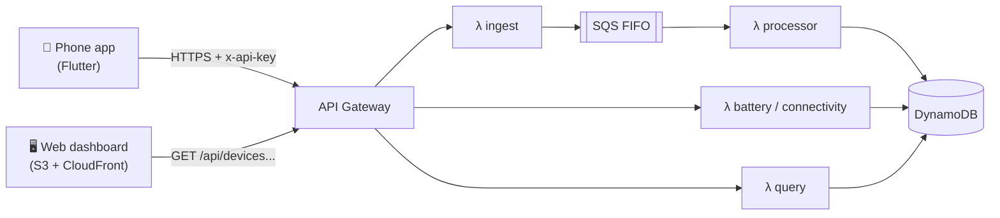

# DataInfrastructure_404PorscheNotFound

Codelap Hackathon 2026 – Data-Driven Infrastructure Engineering.

**Project:** Field Device & Mobile Fleet Health Monitoring — an end-to-end solution that captures data from a mobile phone, sends it securely to AWS, processes and stores it in the cloud, and visualizes it in a web dashboard.

## Architecture



The AWS resources are defined with **AWS CDK (TypeScript)** as four independently deployable
stacks (web, data, lambdas, api) and deployed by **GitHub Actions** via OIDC (no stored AWS keys).

**Full documentation:** [docs/infrastructure.md](docs/infrastructure.md) – architecture,
stacks, workflows, configuration, how to deploy and troubleshoot.

## Repository structure

```
DataInfrastructure_404PorscheNotFound/
├── src/
│   ├── mobile-app/tele/   # Flutter phone app: reads battery/charging/acceleration, sends JSON events
│   ├── backend/           # Python Lambda handlers (ingest, processor, query, battery, connectivity) + tests
│   └── web-dashboard/     # React + Vite dashboard: device list, latest values, history
├── infrastructure/        # AWS CDK app (TypeScript)
│   ├── bin/app.ts         # Stack wiring and deploy order
│   └── lib/
│       ├── stacks/        # WebStack, DataStack, LambdaStack, ApiStack
│       ├── constructs/    # Reusable building blocks used by the stacks
│       └── naming.ts      # Fixed resource names shared by the stacks
├── .github/workflows/     # CI/CD: infra, Lambda code, frontend, mobile APK, AWS bootstrap, deploy role update
├── docs/                  # Infrastructure and deployment documentation
├── presentation/          # Final presentation: DataInfrastructure_404PorscheNotFound.pptx
└── README.md
```

## Setup and installation

1. One-time AWS setup (bootstrap + GitHub deploy role): [docs/infrastructure.md § 5.1](docs/infrastructure.md#51-first-time-setup-of-a-new-aws-account).
2. Merge to `main` (or run the workflows by hand): infrastructure, Lambda code and dashboard deploy automatically.
3. Set the `INGESTION_URL` variable and `INGESTION_API_KEY` secret, then run **Mobile APK** and install the APK on the phones.

Component-specific setup: [src/web-dashboard/README.md](src/web-dashboard/README.md),
[src/mobile-app/tele/README.md](src/mobile-app/tele/README.md).

## Running the solution

- **Dashboard:** `DashboardUrl` output of the `fleet-telemetry-web` stack (also in the Frontend deploy run summary).
- **Phone:** install the APK from the **Mobile APK** run's artifacts; it starts sending every 5 s.
- **API check:** open `<ApiBaseUrl>/api/devices` in a browser.

## Dependencies

| Part | Needs |
|---|---|
| Infrastructure | Node 22, AWS CDK 2 (installed by `npm ci` in `infrastructure/`) |
| Backend | Python 3.13 (Lambda runtime), boto3 (provided by Lambda) |
| Dashboard | Node 22, Vite |
| Mobile app | Flutter stable, Java 17, Android SDK |

## Tools and technologies

AWS (API Gateway, Lambda, SQS FIFO, DynamoDB, S3, CloudFront, SSM, CloudWatch, IAM/OIDC),
AWS CDK (TypeScript), Python, React + Vite, Flutter, GitHub Actions.
