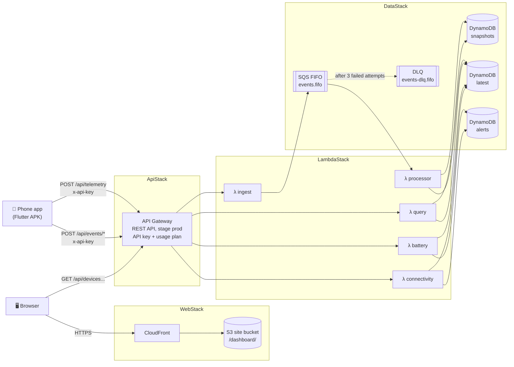
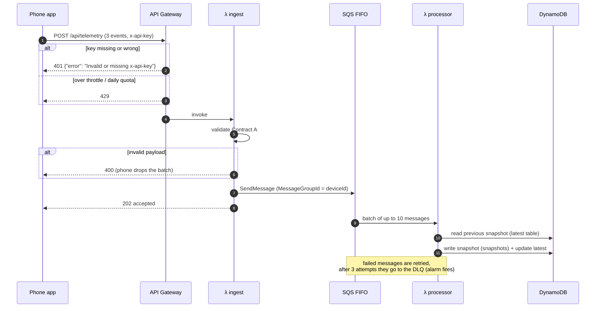
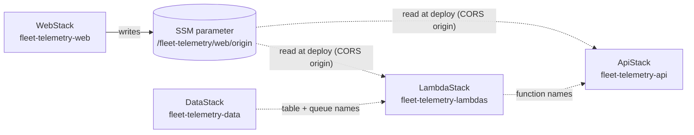
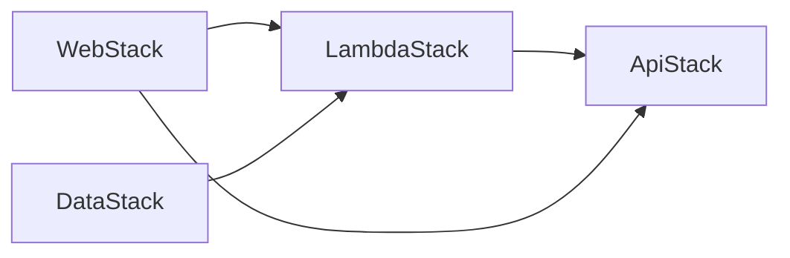
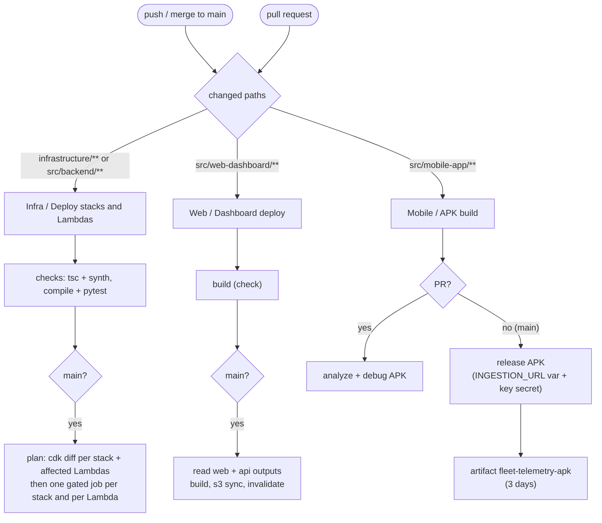
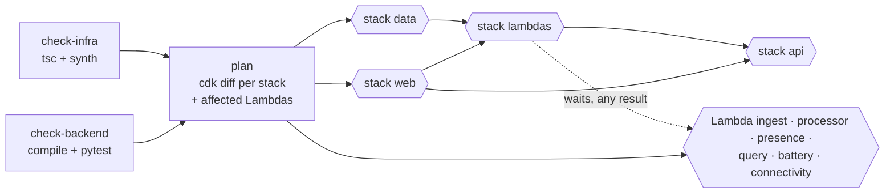
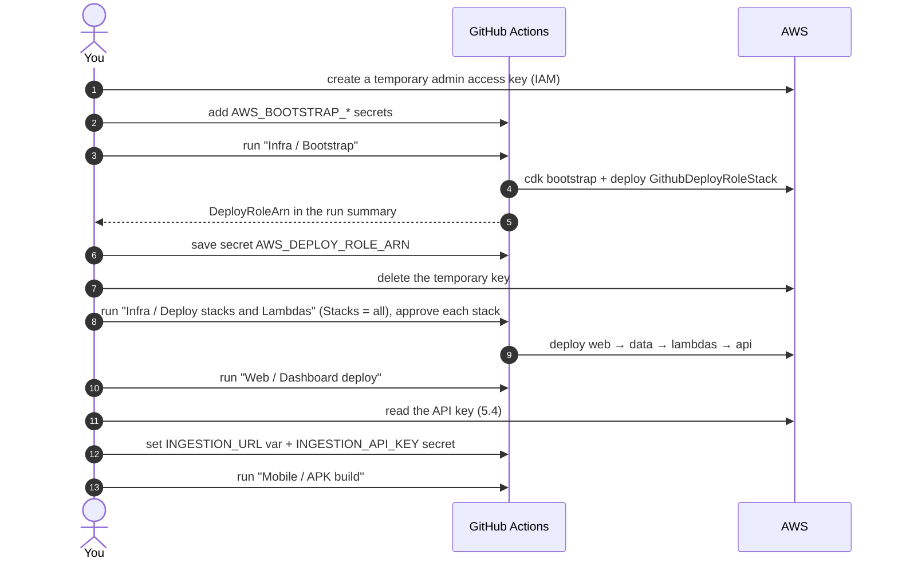

# Infrastructure and deployment

How the fleet telemetry platform runs on AWS, how it is split into CDK stacks, how the
GitHub Actions workflows build and deploy it, and how to operate it day to day.

- [1. Architecture](#1-architecture)
- [2. CDK stacks](#2-cdk-stacks)
- [3. GitHub Actions workflows](#3-github-actions-workflows)
- [4. Configuration reference](#4-configuration-reference)
- [5. How to use it](#5-how-to-use-it)
- [6. Moving from the single stack (one-time)](#6-moving-from-the-single-stack-one-time)
- [7. Troubleshooting](#7-troubleshooting)

---

## 1. Architecture

Everything is serverless and lives in one AWS account and region (`eu-west-1` by default).



### Request flow: one telemetry batch



### Components

| Component | Purpose | Key settings |
|---|---|---|
| **API Gateway** (`fleet-telemetry-api`) | Public HTTPS entry point | Stage `prod`, 10 req/s (burst 20) for the whole stage; CORS limited to the dashboard origin |
| **API key** (`fleet-telemetry-ingestion-key`) | Protects the `POST` routes | Usage plan: 5 req/s (burst 10), 20 000 requests/day; 401 with a JSON body when missing |
| **λ ingest** | `POST /api/telemetry`: validates Contract A, queues the batch | 10 s timeout |
| **SQS FIFO** (`fleet-telemetry-events.fifo`) | Buffer between ingestion and processing | Ordered per device (`MessageGroupId = deviceId`), content-based dedup (5 min), visibility 180 s |
| **DLQ** (`fleet-telemetry-events-dlq.fifo`) | Messages that failed 3 times | Kept 14 days; alarm `fleet-telemetry-events-dlq-not-empty` |
| **λ processor** | Builds health snapshots (drain rate etc.) | SQS trigger: batch 10, max 2 concurrent, partial batch failures |
| **λ query** | `GET /api/devices`, `/api/devices/{deviceId}/telemetry`, `/api/devices/{deviceId}/alerts`, `/api/devices/{deviceId}/path` | Read-only on snapshots, latest and alerts |
| **λ battery** | `POST /api/events/battery-low`, `/battery-last-call` | Thresholds 0.20 / 0.10 |
| **λ connectivity** | `POST /api/events/connectivity-degraded`, `/connectivity-last-call` | Drop of 2 bars in 60 s, lost below −110 dBm |
| **λ presence** | Every minute (EventBridge): marks silent devices SUSPECT / OFFLINE | Suspect after 60 s, offline after 240 s more; no retries |
| **DynamoDB** `snapshots` | Full history per device | PK `deviceId`, SK `timestamp`, TTL `expiresAt` |
| **DynamoDB** `latest` | Newest snapshot per device | PK `deviceId` |
| **DynamoDB** `alerts` | Last-call, status and presence events | PK `deviceId`, SK `<timestamp>#<alertType>`, TTL `expiresAt` |
| **S3 + CloudFront** | Hosts the dashboard at `/dashboard/` | Private bucket (origin access control); `/` redirects to `/dashboard/` |

All Lambdas run Python 3.13 on ARM64 with 256 MB and log to `/aws/lambda/<function>` (kept one
week). Tables are on-demand, capped at
100 read/write units per second each.

### Lambda code layout

```text
src/backend/
├── functions/                one self-contained folder per Lambda (no shared package)
│   ├── ingest/               handler.py, checks.py, contract_a.py
│   ├── processor/            handler.py, snapshot.py, checks.py, contract_a.py, dynamo.py, travel.py
│   ├── query/                handler.py
│   ├── battery/              handler.py, validation.py, checks.py, dynamo.py, travel.py, events.py, event_body.py
│   ├── connectivity/         handler.py, validation.py, checks.py, dynamo.py, travel.py, events.py, event_body.py
│   └── presence/             handler.py, rules.py, checks.py, dynamo.py
├── tests/                    unittest / pytest, run from src/backend (includes test_copies.py)
└── requirements.txt          runtime deps (boto3 is in the Lambda runtime, nothing is bundled)
```

Every function folder bundles **all** the code that function runs, and is packaged on its own
(CDK asset in `telemetry-functions.ts`, and the same zip in the Lambda code jobs). The handler
setting is `functions.<name>.handler.handler`; modules import each other with
`from .<module> import ...`.

Function-specific modules:

| Module | Function | Contains |
|---|---|---|
| `snapshot.py` | processor | health snapshot rules (activity, drain rate, alert status) |
| `validation.py` | battery | Contracts D1, D2 + battery thresholds |
| `validation.py` | connectivity | Contracts E1, E2 + signal thresholds |
| `rules.py` | presence | Contract F presence rules and timers |

Helper modules that several functions need are **copied** into each of them:

| Helper module | Contains | Copied into |
|---|---|---|
| `checks.py` | basic checks: ValidationError, numbers, timestamps, location, heading | ingest, processor, battery, connectivity, presence |
| `contract_a.py` | Contract A batch validation | ingest, processor |
| `travel.py` | normalize_timestamp, derive_travel_status | processor, battery, connectivity |
| `dynamo.py` | to_dynamo, conditional-write check, alert TTL | processor, presence, battery, connectivity |
| `events.py` | event flow: parse, validate, store, 202 | battery, connectivity |
| `event_body.py` | body checks common to the event contracts | battery, connectivity |

**The copies must stay identical.** `tests/test_copies.py` fails when two copies of a helper
differ, or when a copy exists that is not listed in it. To change a helper, edit one copy, copy
the file over the others, and deploy each function that carries it. Each copy has its own
`ValidationError` class, so a test must catch the one of the function it calls.

To add a function: create `functions/<name>/__init__.py` and `functions/<name>/handler.py` with
`def handler(event, context)`, add `<name>` to `FUNCTION_NAMES` in `lib/naming.ts`, create it in
`telemetry-functions.ts`, and add a `lambda-<name>` job (and environment) to `infra-deploy.yml`.

### API routes

| Method | Path | Lambda | Auth |
|---|---|---|---|
| POST | `/api/telemetry` | ingest | `x-api-key` |
| POST | `/api/events/battery-low` | battery | `x-api-key` |
| POST | `/api/events/battery-last-call` | battery | `x-api-key` |
| POST | `/api/events/connectivity-degraded` | connectivity | `x-api-key` |
| POST | `/api/events/connectivity-last-call` | connectivity | `x-api-key` |
| GET | `/api/devices` | query | none |
| GET | `/api/devices/{deviceId}/telemetry?limit=N` | query | none |

Base URL: `https://<api-id>.execute-api.<region>.amazonaws.com/prod` (output `ApiBaseUrl` of the API stack).

---

## 2. CDK stacks

The CDK app (`infrastructure/`, TypeScript) defines four application stacks plus a one-time
IAM stack:

| CDK id | CloudFormation name | Contains | Source |
|---|---|---|---|
| `WebStack` | `fleet-telemetry-web` | S3 bucket, CloudFront, routing function, SSM parameter with the site origin | `lib/stacks/web-stack.ts` |
| `DataStack` | `fleet-telemetry-data` | 3 DynamoDB tables, SQS queue + DLQ, DLQ alarm | `lib/stacks/data-stack.ts` |
| `LambdaStack` | `fleet-telemetry-lambdas` | 6 Lambda functions, their roles, log groups, SQS trigger, presence schedule | `lib/stacks/lambda-stack.ts` |
| `ApiStack` | `fleet-telemetry-api` | REST API, routes, invoke permissions, API key, usage plan | `lib/stacks/api-stack.ts` |
| `GithubDeployRoleStack` | `fleet-telemetry-github-deploy` | OIDC provider + IAM role used by GitHub Actions | `lib/github-deploy-role-stack.ts` |

The reusable building blocks (`lib/constructs/`) are unchanged in spirit: each stack wraps one
or two of them.

### How the stacks find each other

The stacks **never use CloudFormation exports** (`Fn::ImportValue`). An export locks the
producing stack: CloudFormation refuses to change or delete it while another stack imports it,
which would make independent deploys impossible. Instead:

- Every resource has a **fixed name** derived from the project name (`lib/naming.ts`), and the
  consuming stack builds the ARN from that name (`TableV2.fromTableName`, `Queue.fromQueueAttributes`,
  `Function.fromFunctionAttributes`).
- The one value that cannot be fixed, the CloudFront domain, is written by the web stack to the
  **SSM parameter** `/fleet-telemetry/web/origin`. The Lambda and API stacks read it as a
  CloudFormation dynamic parameter **at deploy time** (used as the CORS origin).



Solid arrows create something; dotted arrows are lookups by name. The CDK app also declares
the deploy order (`addStackDependency` in `bin/app.ts`):



That order matters for the **first** deploy (a stack can only look up what already exists) and
when several stacks are deployed in one command. After that, each stack can be deployed alone
with `cdk deploy --exclusively <StackId>`.

### What to redeploy for a change

| You changed | Redeploy | Notes |
|---|---|---|
| `lib/constructs/web-hosting.ts`, `lib/stacks/web-stack.ts` | WebStack | If the CloudFront domain changes, also redeploy LambdaStack and ApiStack (CORS) |
| `lib/constructs/telemetry-tables.ts`, `telemetry-queue.ts`, `lib/stacks/data-stack.ts` | DataStack | Renaming a table/queue also needs LambdaStack |
| `lib/constructs/telemetry-functions.ts`, `lib/stacks/lambda-stack.ts` | LambdaStack | Settings, env vars, permissions, code |
| `lib/constructs/telemetry-api.ts`, `lib/stacks/api-stack.ts` | ApiStack | |
| `src/backend/functions/<name>/**` | lambdas (that function's package) | Approve that Lambda job, or the lambdas stack job |
| `lib/naming.ts`, `bin/app.ts`, `cdk.json`, `package*.json` | all four | |

### Deploy role permissions

GitHub Actions authenticates through OIDC (no stored AWS keys) and assumes
`fleet-telemetry-github-deploy`. That role can only:

- assume the CDK bootstrap roles (`cdk-hnb659fds-*`), which perform the actual CloudFormation deploys;
- read outputs of stacks named `fleet-telemetry-*`;
- update the code of functions named `fleet-telemetry-*`;
- upload to the site bucket and invalidate CloudFront.

It is trusted only for pushes to `main` of this repository. The new stack names all match the
existing `fleet-telemetry-*` patterns, so the role did not need to change for the split.

To change these permissions, edit `lib/github-deploy-role-stack.ts` and run the
**Infra / Deploy role** workflow (section 3). Because CloudFormation runs through the CDK
bootstrap roles, the deploy role can update its own stack, but only while GitHub can still log
in to it.

---

## 3. GitHub Actions workflows

GitHub only runs workflow files placed directly in `.github/workflows/` (subfolders are
ignored), so the structure comes from a name prefix per area plus shared steps in their own
folder:

```text
.github/
├── workflows/
│   ├── infra-bootstrap.yml        Infra / Bootstrap (one-time)
│   ├── infra-deploy-role.yml      Infra / Deploy role
│   ├── infra-deploy.yml           Infra / Deploy stacks and Lambdas   (one manual job per stack and per Lambda)
│   ├── infra-deploy-stack.yml     reusable: cdk deploy of one stack
│   ├── infra-deploy-lambda.yml    reusable: code update of one Lambda
│   ├── web-dashboard-deploy.yml   Web / Dashboard deploy
│   ├── mobile-apk-build.yml       Mobile / APK build
│   └── mobile-apk-release.yml     Mobile / APK release   (tag mobile-v*: signed, versioned APK)
└── actions/                       shared steps (composite actions)
    ├── setup-cdk/                 Node + npm ci in infrastructure/ (cached)
    └── aws-login/                 checks AWS_DEPLOY_ROLE_ARN, then assumes the deploy role (OIDC)
```

The display names start with the same area (`Infra /`, `Web /`, `Mobile /`), so the Actions
sidebar lists them grouped.

| Workflow | File | Runs on | Does |
|---|---|---|---|
| Infra / Bootstrap (one-time) | `infra-bootstrap.yml` | manual, once per account | `cdk bootstrap` + creates the deploy role |
| Infra / Deploy role | `infra-deploy-role.yml` | manual, from `main` | diff, approval, then updates the deploy role's permissions |
| Infra / Deploy stacks and Lambdas | `infra-deploy.yml` | `infrastructure/**`, `src/backend/**` | checks; on `main`: diff per stack + affected Lambdas, then one approval-gated job per stack and per Lambda |
| Web / Dashboard deploy | `web-dashboard-deploy.yml` | `src/web-dashboard/**` | builds the dashboard; on `main`: uploads to S3 + invalidates CloudFront |
| Mobile / APK build | `mobile-apk-build.yml` | `src/mobile-app/**` | analyze + debug build; on `main`: release APK as an artifact |
| Mobile / APK release | `mobile-apk-release.yml` | tag `mobile-v*`, or manual | release APK with the version from the tag, signed with the release key, as an artifact |

Every workflow except the two manual ones also runs on pull requests (checks only, nothing is
deployed), and all of them can be started by hand from **Actions → (workflow) → Run workflow**.



### Infra / Deploy stacks and Lambdas

Every backend deploy in one workflow: each stack and each Lambda's code is its own job that
waits for manual approval, like manual jobs in a GitLab pipeline.



1. **Checks** – `tsc --noEmit` + `cdk synth`, and for the Lambdas `compileall` + `pytest`
   (including the copy check). Pull requests stop here.
2. **Plan** (only `main`) – runs `cdk diff --exclusively` for each stack (each diff is in the run
   summary, collapsed under the stack's name) and works out which Lambdas to offer. The summary
   ends with the list of offered jobs.
3. **Stack jobs** – `infra-deploy-stack.yml` runs `cdk deploy <Stack> --exclusively` in the
   environment `stack-<name>`.
4. **Lambda jobs** – `infra-deploy-lambda.yml` zips `functions/<name>/` (the same package CDK
   builds), checks the function exists and is configured for that layout
   (handler `functions.<name>.handler.handler`), runs `update-function-code` for that one function
   and waits until it is active, in the environment `lambda-<name>`. No CloudFormation run, so it
   takes seconds.

Open the run, click **Review deployments**, tick the jobs you want and **Approve and deploy**;
reject the others. With required reviewers on the environments (section 4), nothing deploys
without that click.

**Order.**
- Stacks: web and data first (in parallel), lambdas after data and web, api after lambdas and
  web. A stack job starts only after the stacks it depends on were deployed or had nothing to
  deploy; rejecting or failing a stack skips the stacks after it.
- Lambdas: each waits only for the **lambdas stack** job to finish, whatever its result. Approve
  that job to update every function through CloudFormation; reject it to deploy just the Lambdas
  you approve. Waiting for it guarantees that a newly added function exists before its code is
  updated.

**Which Lambdas are offered.** On a merge, the ones whose folder changed (paths relative to
`src/backend`):

| Changed file | Lambdas offered |
|---|---|
| `functions/<name>/**` | that function |
| `functions/__init__.py` | all |
| `tests/**`, `requirements*.txt`, anything else | none |

A change to a helper copied into several folders (e.g. all `dynamo.py` copies) offers each of
those functions. A Lambda is any `functions/<name>/handler.py`; `<name>` must match the function
name in `lib/naming.ts` (`FUNCTION_NAMES`).

The **lambdas stack** diff follows the same packages: a change in `functions/battery/` changes only
the battery function in CloudFormation. You can reject the stack job and approve only the Lambda
jobs.

**Manual runs** (**Run workflow** on `main`):

| Stacks | Lambda code | Result |
|---|---|---|
| `changed` (default) | `none` (default) | Like a merge without Lambda jobs: only stacks with differences |
| `none` | `battery` | Only the battery code job; no stack is touched, no AWS diff runs |
| `none` | `all` | One job per function; approve any of them |
| `api` | `none` | Only the api stack, even if other stacks have differences |
| `all` | `none` | Every stack, even without differences (e.g. to recreate one deleted by hand) |

**Concurrency.** Two runs never deploy the same stack (group `infra-stack-<Stack>`) or the same
function (group `aws-lambda-<name>`) at once; a newer waiting run replaces an older waiting one.
The lambdas stack job uses `aws-backend-deploy`, shared with Infra / Deploy role.

### Web / Dashboard deploy

Reads `SiteBucketName`, `DistributionId` and `DashboardUrl` from **fleet-telemetry-web** and
`ApiBaseUrl` from **fleet-telemetry-api**, builds the dashboard with
`VITE_API_BASE_URL=<ApiBaseUrl>`, syncs `dist/` to `s3://<bucket>/dashboard/` and invalidates
`/dashboard/*`. The dashboard URL is printed in the run summary.

### Mobile / APK build

Builds `src/mobile-app/tele`. On `main` it needs the repository variable `INGESTION_URL` and the
secret `INGESTION_API_KEY`; it does **not** set `DEVICE_ID`, so each phone generates its own.
Download the APK from the run's **Artifacts** section (kept 3 days). These builds are signed with
Flutter's debug key and always have version 1.0.0 (1): use them for testing, and the release
workflow below for the phones.

### Mobile / APK release

A versioned APK signed with the project's own key, so each release installs over the previous one.

```powershell
git tag mobile-v1.2.0
git push origin mobile-v1.2.0
```

1. **Read version** – `1.2.0` from the tag (must be `X.Y.Z`); the versionCode is the workflow's
   run number, so it always increases. The tagged commit must be on `main`.
2. **Check settings** – `INGESTION_URL`, `INGESTION_API_KEY` and the four `ANDROID_*` secrets
   (section 4). A missing one fails the run instead of producing a debug-signed APK.
3. **Build** – `flutter build apk --release --build-name 1.2.0 --build-number <run number>` with
   the same `--dart-define`s as Mobile / APK build.
4. **Sign** – Flutter signs release builds with the debug key (`android/app/build.gradle.kts`),
   so the workflow re-signs the APK with `zipalign` + `apksigner` from the Android SDK, using the
   keystore from the secrets. It then checks there is exactly one signer and that it is not the
   debug key. The app code is not changed.
5. **Upload** – artifact `fleet-telemetry-<version>` (kept 7 days); the summary shows the version
   and the signing certificate's SHA-256.

There is deliberately **no GitHub Release**: the APK contains the ingestion API key, and assets of
a release in this public repo could be downloaded by anyone, forever. Without a tag, run it from
**Actions → Mobile / APK release → Run workflow** on `main` with a version.

**First install of a release-signed APK:** a phone that has an APK signed with a different key
(a Mobile / APK build artifact, or `flutter run`) must uninstall the app once; Android refuses to
update an app with a different signature. After that, every release installs over the previous
one. The device id is generated again after the uninstall.

### Infra / Bootstrap (one-time)

Uses a temporary admin access key (`AWS_BOOTSTRAP_*` secrets) to run `cdk bootstrap` and deploy
`GithubDeployRoleStack`. Afterwards save `DeployRoleArn` as `AWS_DEPLOY_ROLE_ARN` and delete
the temporary key. See section 5.

### Infra / Deploy role

Changes the deploy role's own permissions using the deploy role itself, so no admin key is
needed. Use it when a workflow needs a new AWS permission: edit
`infrastructure/lib/github-deploy-role-stack.ts`, merge to `main`, then run it from
**Actions → Infra / Deploy role → Run workflow** (branch `main`; the role only trusts `main`).


1. **Show changes** – `cdk diff` of `GithubDeployRoleStack` only; the diff is in the run summary.
   If there are no differences, the run ends here.
2. **Deploy (needs approval)** – runs in the GitHub environment `deploy-role`. With required
   reviewers set (section 4), the run pauses until someone clicks **Review deployments →
   Approve** after reading the diff. Shares the `aws-backend-deploy` concurrency group, so it
   never runs next to the lambdas stack deploy.
3. **Check the role still works** – requests a fresh token and logs in again. If that fails, the
   change broke the trust policy and the summary says how to repair it.

**Limits:** it cannot repair a role GitHub can no longer log in to; that needs an admin (IAM
console → Roles → `fleet-telemetry-github-deploy` → Trust relationships, or the Infra / Bootstrap
workflow). Be especially careful with changes to `githubRepo`, `githubImmutableSubjectPrefix` or
the trust conditions.

---

## 4. Configuration reference

### CDK context (`infrastructure/cdk.json`)

| Key | Default | Meaning |
|---|---|---|
| `projectName` | `fleet-telemetry` | Prefix of every resource and stack name |
| `region` | `eu-west-1` | Region of all stacks |
| `lambdaReservedConcurrency` | `0` (code default 2) | Max instances per function; keep `0` on new accounts whose concurrency limit is 10 |
| `allowedOrigin` | unset | CORS origin override, e.g. `-c allowedOrigin=http://localhost:5173`; unset = the CloudFront origin from SSM |
| `githubRepo` | `lupseIV/DataInfrastructure_404PorscheNotFound` | Repository allowed to assume the deploy role |
| `githubImmutableSubjectPrefix` | set | GitHub's id-based OIDC subject for the same repository |
| `githubOidcProviderArn` | unset | Reuse an existing GitHub OIDC provider instead of creating one |

### GitHub settings (Settings → Secrets and variables → Actions)

| Name | Kind | Used by | Value |
|---|---|---|---|
| `AWS_DEPLOY_ROLE_ARN` | secret | all deploy jobs | Output `DeployRoleArn` of the bootstrap workflow |
| `AWS_REGION` | variable (optional) | all AWS workflows | Defaults to `eu-west-1` |
| `INGESTION_URL` | variable | Mobile / APK build | `<ApiBaseUrl>/api/telemetry` |
| `INGESTION_API_KEY` | secret | Mobile / APK build, Mobile / APK release | API key value (see 5.4) |
| `ANDROID_KEYSTORE_BASE64` | secret | Mobile / APK release | The release keystore (`.jks`) as base64 (see 5.5) |
| `ANDROID_KEYSTORE_PASSWORD` | secret | Mobile / APK release | Keystore password |
| `ANDROID_KEY_ALIAS` | secret | Mobile / APK release | Alias of the key in the keystore, e.g. `fleet-telemetry` |
| `ANDROID_KEY_PASSWORD` | secret | Mobile / APK release | Key password (the same as the keystore password if you used the commands in 5.5) |
| `AWS_BOOTSTRAP_ACCESS_KEY_ID`, `AWS_BOOTSTRAP_SECRET_ACCESS_KEY` | secret | Infra / Bootstrap | Temporary admin key; delete after bootstrapping |

### GitHub environments (Settings → Environments)

| Environment | Used by | Set up |
|---|---|---|
| `deploy-role` | Infra / Deploy role (deploy job) | **Required reviewers**: add yourself. Without them GitHub creates the environment on the first run with no protection, and the deploy does not wait for approval. Optionally restrict **Deployment branches** to `main`. |
| `stack-web`, `stack-data`, `stack-lambdas`, `stack-api`, `lambda-ingest`, `lambda-processor`, `lambda-query`, `lambda-battery`, `lambda-connectivity` | Infra / Deploy stacks and Lambdas (one per job) | **Required reviewers** on each, so every job waits for approval. Same warning: an environment without reviewers is created unprotected on the first run and that job deploys without waiting. Optionally restrict **Deployment branches** to `main`. |

### Stack outputs

| Stack | Output | Used for |
|---|---|---|
| web | `DashboardUrl` | Open the dashboard |
| web | `SiteBucketName`, `DistributionId` | Web / Dashboard deploy |
| web | `SiteOrigin` | Same value as the SSM parameter |
| data | `SnapshotsTableName`, `LatestTableName`, `AlertsTableName` | Debugging in the console |
| data | `EventsQueueUrl`, `EventsDeadLetterQueueUrl` | Inspecting / redriving messages |
| lambdas | `FunctionNames` | The functions the Lambda jobs update |
| api | `ApiBaseUrl` | Dashboard build, `INGESTION_URL` |
| api | `AllowedOrigin` | Check the CORS origin in effect |
| api | `IngestionApiKeyId`, `GetIngestionApiKeyCommand` | Retrieve the API key |

The outputs of the latest **Infra / Deploy stacks and Lambdas** run (one block per deployed stack) are in its summary, or in the
CloudFormation console → stack → **Outputs**.

---

## 5. How to use it

### 5.1 First-time setup of a new AWS account



### 5.2 Everyday changes

Open a pull request: the matching workflows run their checks. Merge to `main`: they deploy.
Use the table in [What to redeploy for a change](#what-to-redeploy-for-a-change) to know what
will be touched.

To re-run a deploy without a code change: **Actions → (workflow) → Run workflow → main**.

### 5.3 Deploying from your machine

Needs Node 22, AWS credentials with admin rights (your `lupse` IAM user is **not** enough) and
the bootstrapped account.

```powershell
cd infrastructure
npm ci
npx cdk diff                                         # what would change, per stack
npx cdk deploy --exclusively LambdaStack             # just one stack
npx cdk deploy WebStack DataStack LambdaStack ApiStack   # all four, in order
```

`--exclusively` (`-e`) skips the dependencies; without it, CDK also deploys the stacks the
chosen one depends on.

### 5.4 Getting the ingestion API key

AWS console → **API Gateway** (region eu-west-1) → **API keys** → `fleet-telemetry-ingestion-key`
→ **Show**. Or, with credentials that may call `apigateway:GET`, run the command in the API
stack's `GetIngestionApiKeyCommand` output.

### 5.5 Creating the release signing key (once)

Needs a JDK on your machine (`keytool`). Keep `release.jks` and its password somewhere safe
outside the repo: **if the key is lost, the installed app can never be updated again**, only
uninstalled and reinstalled.

```powershell
keytool -genkeypair -v -keystore release.jks -alias fleet-telemetry -keyalg RSA -keysize 2048 -validity 10000 -dname "CN=Fleet Telemetry, O=404PorscheNotFound"
```

`keytool` asks for a password; with a PKCS12 keystore (the default) the key uses the same one.
Copy the keystore as base64 to the clipboard:

```powershell
[Convert]::ToBase64String([IO.File]::ReadAllBytes("$PWD\release.jks")) | Set-Clipboard
```

Then in **Settings → Secrets and variables → Actions** add `ANDROID_KEYSTORE_BASE64` (paste),
`ANDROID_KEYSTORE_PASSWORD` and `ANDROID_KEY_PASSWORD` (the password), and `ANDROID_KEY_ALIAS`
(`fleet-telemetry`). Never commit `release.jks`.

### 5.6 Watching it run

| What | Where |
|---|---|
| Lambda logs | CloudWatch → Log groups → `/aws/lambda/fleet-telemetry-<function>` |
| Failed events | SQS → `fleet-telemetry-events-dlq.fifo`; alarm `fleet-telemetry-events-dlq-not-empty` |
| Stored data | DynamoDB → Tables → `fleet-telemetry-snapshots` / `-latest` / `-alerts` → Explore items |
| API traffic | API Gateway → `fleet-telemetry-api` → Dashboard |
| Quick API check | open `<ApiBaseUrl>/api/devices` in a browser |

---

## 6. Moving from the single stack (one-time)

Until this change everything lived in one stack, **`fleet-telemetry-stack`**. The new stacks
create resources with the **same fixed names** (tables, queues, functions, bucket, log groups),
so they cannot be created while the old stack still exists. The migration is a **recreate**:

> **What you lose:** all DynamoDB data so far, the dashboard's CloudFront URL, the API base URL
> and the API key (all are regenerated).


Notes:

- Deleting needs an admin login in the console; the GitHub deploy role cannot delete stacks.
- The S3 bucket is emptied automatically before deletion (auto-delete is on).
- If Infra / Deploy stacks and Lambdas ran before the old stack was gone, it fails with
  `... already exists`. Finish step 2, then re-run Infra / Deploy stacks and Lambdas.
- The GitHub deploy role (`fleet-telemetry-github-deploy`) is a separate stack and is **kept**.

---

## 7. Troubleshooting

| Symptom | Cause | Fix |
|---|---|---|
| `Configure AWS credentials` fails | Deploy role trust policy or `AWS_DEPLOY_ROLE_ARN` wrong | Check the secret; fix the trust policy as admin (IAM console or Infra / Bootstrap) |
| A workflow gets `AccessDenied` for a new AWS action | The deploy role lacks that permission | Add it in `github-deploy-role-stack.ts`, merge, run **Infra / Deploy role** |
| Infra / Deploy role: "Show changes" skipped | Started from a branch other than `main` | Run it with branch `main` |
| Infra / Deploy role deployed without waiting | Environment `deploy-role` has no required reviewers | Add reviewers (section 4) |
| `Resource of type ... with identifier ... already exists` | Old `fleet-telemetry-stack` (or a leftover resource) still exists | Delete it (section 6), re-run the deploy |
| LambdaStack / ApiStack: `Unable to fetch parameters [/fleet-telemetry/web/origin]` | WebStack not deployed yet | Deploy WebStack first (or deploy all four together) |
| ApiStack: `Function not found: fleet-telemetry-...` | LambdaStack not deployed yet | Deploy LambdaStack first |
| Lambda job: "does not exist yet" | Function not created yet | Approve the lambdas stack job, or run with Stacks = lambdas, then deploy the code |
| Lambda job: "runs handler 'handlers.<name>.handler'" | Function still configured for the old single-package layout | Deploy the lambdas stack once (it sets the new handler and code together); later code jobs work |
| Dashboard: CORS errors after WebStack was recreated | Lambda/API still have the old origin | Redeploy LambdaStack and ApiStack |
| Phone gets 401 | Wrong or old key in the APK | Update `INGESTION_API_KEY`, rebuild the APK |
| Phone gets 429 | Throttle or the 20 000/day quota | Increase the send interval or the quota (`telemetry-api.ts`) |
| Stack stuck in `DELETE_FAILED` | Usually a non-empty or in-use resource | CloudFormation → Events shows which; remove it by hand and retry |
