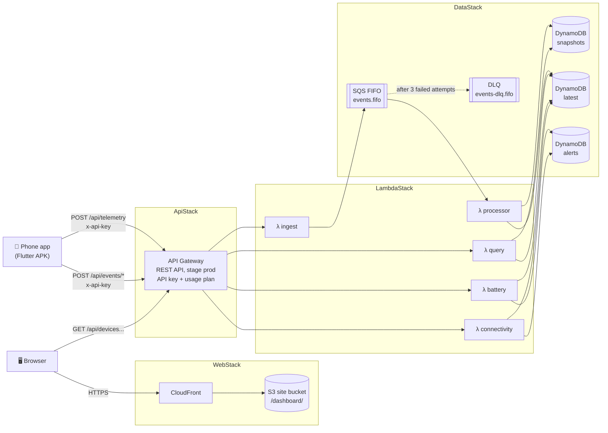
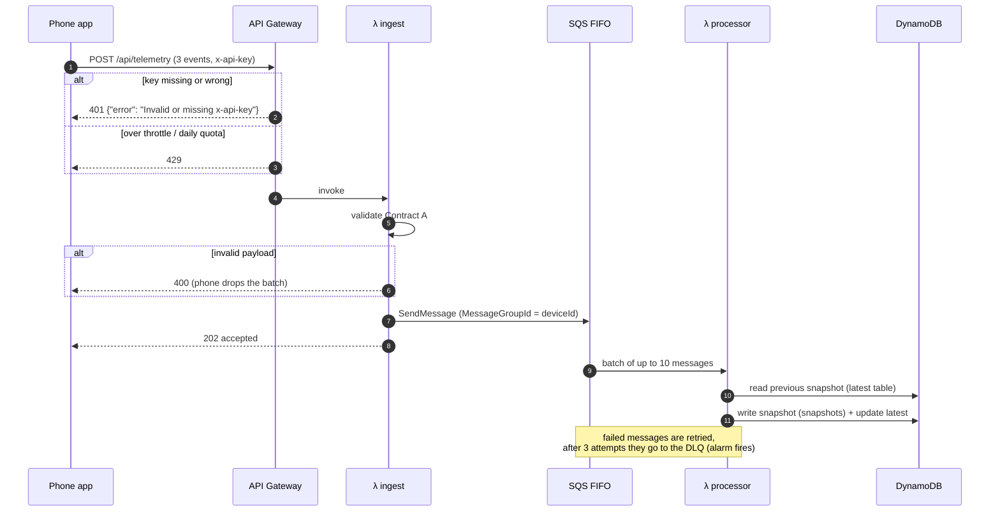
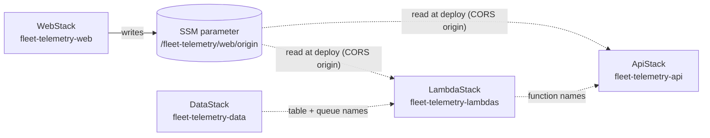
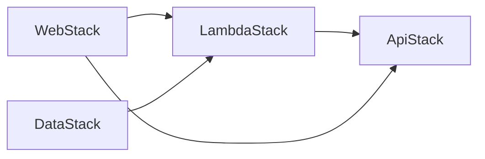
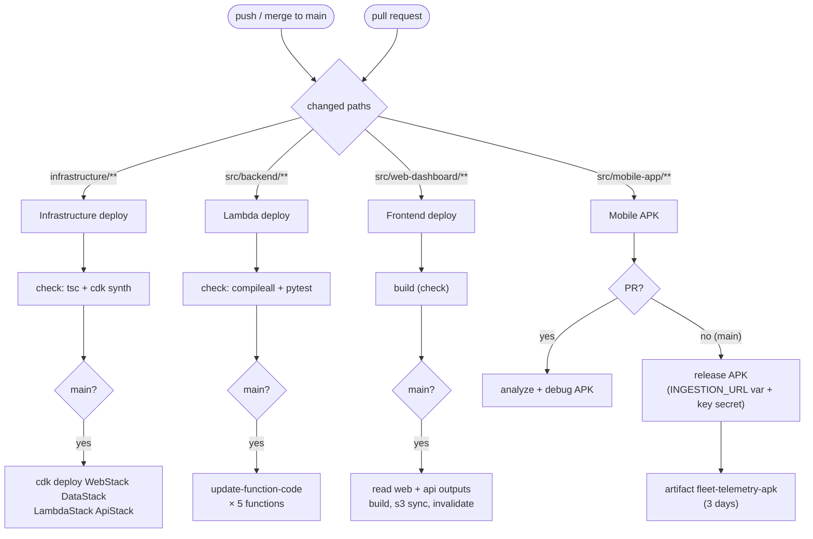
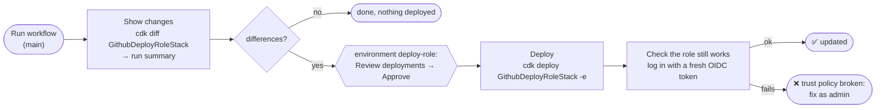
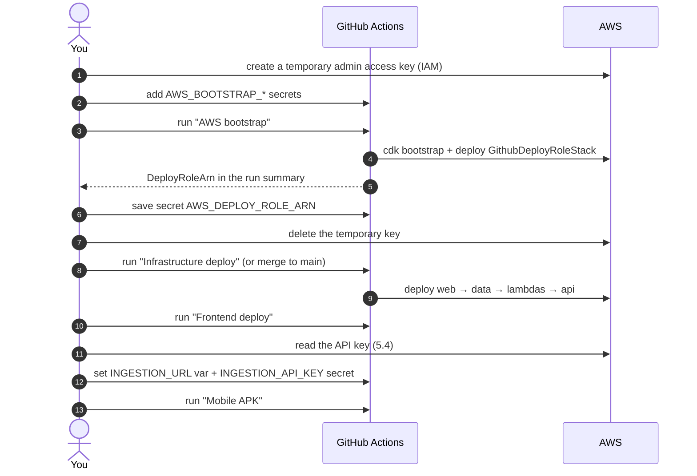
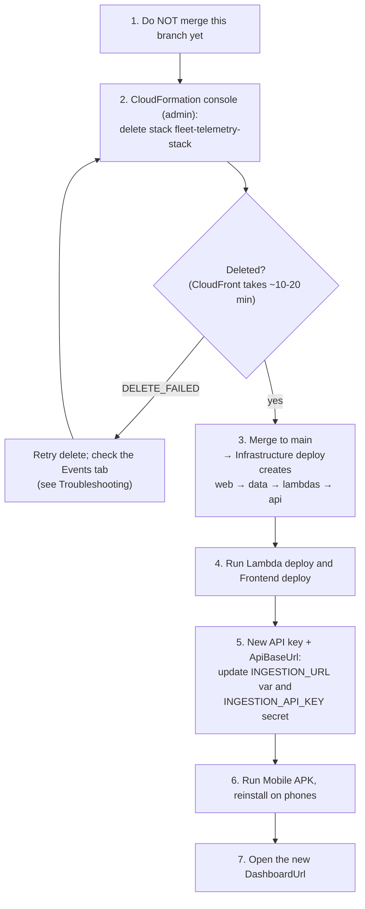

# Infrastructure and deployment

How the fleet telemetry platform runs on AWS, how it is split into CDK stacks, how the
GitHub Actions workflows build and deploy it, and how to operate it day to day.

- [1. Architecture](#1-architecture)
- [2. CDK stacks](#2-cdk-stacks)
- [3. GitHub Actions workflows](#3-github-actions-workflows)
- [4. Configuration reference](#4-configuration-reference)
- [5. How to use it](#5-how-to-use-it)
- [6. Moving from the single stack (one-time)](#6-moving-from-the-single-stack-one-time)
- [7. Troubleshooting](#7-troubleshooting)

---

## 1. Architecture

Everything is serverless and lives in one AWS account and region (`eu-west-1` by default).



### Request flow: one telemetry batch



### Components

| Component | Purpose | Key settings |
|---|---|---|
| **API Gateway** (`fleet-telemetry-api`) | Public HTTPS entry point | Stage `prod`, 10 req/s (burst 20) for the whole stage; CORS limited to the dashboard origin |
| **API key** (`fleet-telemetry-ingestion-key`) | Protects the `POST` routes | Usage plan: 5 req/s (burst 10), 20 000 requests/day; 401 with a JSON body when missing |
| **λ ingest** | `POST /api/telemetry`: validates Contract A, queues the batch | 10 s timeout |
| **SQS FIFO** (`fleet-telemetry-events.fifo`) | Buffer between ingestion and processing | Ordered per device (`MessageGroupId = deviceId`), content-based dedup (5 min), visibility 180 s |
| **DLQ** (`fleet-telemetry-events-dlq.fifo`) | Messages that failed 3 times | Kept 14 days; alarm `fleet-telemetry-events-dlq-not-empty` |
| **λ processor** | Builds health snapshots (drain rate etc.) | SQS trigger: batch 10, max 2 concurrent, partial batch failures |
| **λ query** | `GET /api/devices`, `GET /api/devices/{deviceId}/telemetry` | Read-only on snapshots + latest |
| **λ battery** | `POST /api/events/battery-low`, `/battery-last-call` | Thresholds 0.20 / 0.10 |
| **λ connectivity** | `POST /api/events/connectivity-degraded`, `/connectivity-last-call` | Drop of 2 bars in 60 s, lost below −110 dBm |
| **DynamoDB** `snapshots` | Full history per device | PK `deviceId`, SK `timestamp`, TTL `expiresAt` |
| **DynamoDB** `latest` | Newest snapshot per device | PK `deviceId` |
| **DynamoDB** `alerts` | Last-call, status and presence events | PK `deviceId`, SK `<timestamp>#<alertType>`, TTL `expiresAt` |
| **S3 + CloudFront** | Hosts the dashboard at `/dashboard/` | Private bucket (origin access control); `/` redirects to `/dashboard/` |

All Lambdas run Python 3.13 on ARM64 with 256 MB, share one code package (`src/backend`),
and log to `/aws/lambda/<function>` (kept one week). Tables are on-demand, capped at
100 read/write units per second each.

### API routes

| Method | Path | Lambda | Auth |
|---|---|---|---|
| POST | `/api/telemetry` | ingest | `x-api-key` |
| POST | `/api/events/battery-low` | battery | `x-api-key` |
| POST | `/api/events/battery-last-call` | battery | `x-api-key` |
| POST | `/api/events/connectivity-degraded` | connectivity | `x-api-key` |
| POST | `/api/events/connectivity-last-call` | connectivity | `x-api-key` |
| GET | `/api/devices` | query | none |
| GET | `/api/devices/{deviceId}/telemetry?limit=N` | query | none |

Base URL: `https://<api-id>.execute-api.<region>.amazonaws.com/prod` (output `ApiBaseUrl` of the API stack).

---

## 2. CDK stacks

The CDK app (`infrastructure/`, TypeScript) defines four application stacks plus a one-time
IAM stack:

| CDK id | CloudFormation name | Contains | Source |
|---|---|---|---|
| `WebStack` | `fleet-telemetry-web` | S3 bucket, CloudFront, routing function, SSM parameter with the site origin | `lib/stacks/web-stack.ts` |
| `DataStack` | `fleet-telemetry-data` | 3 DynamoDB tables, SQS queue + DLQ, DLQ alarm | `lib/stacks/data-stack.ts` |
| `LambdaStack` | `fleet-telemetry-lambdas` | 5 Lambda functions, their roles, log groups, SQS trigger | `lib/stacks/lambda-stack.ts` |
| `ApiStack` | `fleet-telemetry-api` | REST API, routes, invoke permissions, API key, usage plan | `lib/stacks/api-stack.ts` |
| `GithubDeployRoleStack` | `fleet-telemetry-github-deploy` | OIDC provider + IAM role used by GitHub Actions | `lib/github-deploy-role-stack.ts` |

The reusable building blocks (`lib/constructs/`) are unchanged in spirit: each stack wraps one
or two of them.

### How the stacks find each other

The stacks **never use CloudFormation exports** (`Fn::ImportValue`). An export locks the
producing stack: CloudFormation refuses to change or delete it while another stack imports it,
which would make independent deploys impossible. Instead:

- Every resource has a **fixed name** derived from the project name (`lib/naming.ts`), and the
  consuming stack builds the ARN from that name (`TableV2.fromTableName`, `Queue.fromQueueAttributes`,
  `Function.fromFunctionAttributes`).
- The one value that cannot be fixed, the CloudFront domain, is written by the web stack to the
  **SSM parameter** `/fleet-telemetry/web/origin`. The Lambda and API stacks read it as a
  CloudFormation dynamic parameter **at deploy time** (used as the CORS origin).



Solid arrows create something; dotted arrows are lookups by name. The CDK app also declares
the deploy order (`addStackDependency` in `bin/app.ts`):



That order matters for the **first** deploy (a stack can only look up what already exists) and
when several stacks are deployed in one command. After that, each stack can be deployed alone
with `cdk deploy --exclusively <StackId>`.

### What to redeploy for a change

| You changed | Redeploy | Notes |
|---|---|---|
| `lib/constructs/web-hosting.ts`, `lib/stacks/web-stack.ts` | WebStack | If the CloudFront domain changes, also redeploy LambdaStack and ApiStack (CORS) |
| `lib/constructs/telemetry-tables.ts`, `telemetry-queue.ts`, `lib/stacks/data-stack.ts` | DataStack | Renaming a table/queue also needs LambdaStack |
| `lib/constructs/telemetry-functions.ts`, `lib/stacks/lambda-stack.ts` | LambdaStack | Settings, env vars, permissions, code |
| `lib/constructs/telemetry-api.ts`, `lib/stacks/api-stack.ts` | ApiStack | |
| `src/backend/**` only | nothing in CDK | Lambda deploy workflow updates the code |
| `lib/naming.ts`, `bin/app.ts`, `cdk.json`, `package*.json` | all four | |

### Deploy role permissions

GitHub Actions authenticates through OIDC (no stored AWS keys) and assumes
`fleet-telemetry-github-deploy`. That role can only:

- assume the CDK bootstrap roles (`cdk-hnb659fds-*`), which perform the actual CloudFormation deploys;
- read outputs of stacks named `fleet-telemetry-*`;
- update the code of functions named `fleet-telemetry-*`;
- upload to the site bucket and invalidate CloudFront.

It is trusted only for pushes to `main` of this repository. The new stack names all match the
existing `fleet-telemetry-*` patterns, so the role did not need to change for the split.

To change these permissions, edit `lib/github-deploy-role-stack.ts` and run the
**Deploy role update** workflow (section 3). Because CloudFormation runs through the CDK
bootstrap roles, the deploy role can update its own stack, but only while GitHub can still log
in to it.

---

## 3. GitHub Actions workflows

| Workflow | File | Runs on | Does |
|---|---|---|---|
| AWS bootstrap | `aws-bootstrap.yml` | manual, once per account | `cdk bootstrap` + creates the deploy role |
| Deploy role update | `deploy-role-update.yml` | manual, from `main` | diff, approval, then updates the deploy role's permissions |
| Infrastructure deploy | `infra-deploy.yml` | `infrastructure/**` | type-check, synth; on `main`: deploys the four stacks |
| Lambda deploy | `lambda-deploy.yml` | `src/backend/**` | compile + tests; on `main`: updates the code of all functions |
| Frontend deploy | `frontend-deploy.yml` | `src/web-dashboard/**` | builds the dashboard; on `main`: uploads to S3 + invalidates CloudFront |
| Mobile APK | `mobile-apk.yml` | `src/mobile-app/**` | analyze + debug build; on `main`: release APK as an artifact |

Every workflow except the two manual ones also runs on pull requests (checks only, nothing is
deployed), and all of them can be started by hand from **Actions → (workflow) → Run workflow**.



### Infrastructure deploy

1. **Type-check and synth** – `npm ci`, `tsc --noEmit`, `cdk synth --quiet`. Runs on every PR.
2. **Deploy to AWS** (only `main`) – assumes the deploy role and runs
   `cdk deploy WebStack DataStack LambdaStack ApiStack`. CDK deploys them in dependency order and
   skips stacks whose template did not change. All outputs go to the run summary.

Shares the concurrency group `aws-backend-deploy` with Lambda deploy, so the two never run at the
same time.

### Lambda deploy

1. **Check Python code** – `python -m compileall handlers` and `pytest tests`.
2. **Deploy Lambda code** (only `main`) – zips `src/backend/handlers` and calls
   `aws lambda update-function-code` for every function, then waits until each one is updated.
   No CloudFormation run, so it takes seconds.

> **Known limitation (fixed in the next step):** if one merge changes both `infrastructure/**`
> and `src/backend/**`, both workflows start together and the shared concurrency group only
> stops them from overlapping, not from running in the wrong order. When a merge **adds** a
> function, Lambda deploy can run first and fail because the function does not exist yet.
> Re-run Lambda deploy after Infrastructure deploy has finished.

### Frontend deploy

Reads `SiteBucketName`, `DistributionId` and `DashboardUrl` from **fleet-telemetry-web** and
`ApiBaseUrl` from **fleet-telemetry-api**, builds the dashboard with
`VITE_API_BASE_URL=<ApiBaseUrl>`, syncs `dist/` to `s3://<bucket>/dashboard/` and invalidates
`/dashboard/*`. The dashboard URL is printed in the run summary.

### Mobile APK

Builds `src/mobile-app/tele`. On `main` it needs the repository variable `INGESTION_URL` and the
secret `INGESTION_API_KEY`; it does **not** set `DEVICE_ID`, so each phone generates its own.
Download the APK from the run's **Artifacts** section (kept 3 days).

### AWS bootstrap (one-time)

Uses a temporary admin access key (`AWS_BOOTSTRAP_*` secrets) to run `cdk bootstrap` and deploy
`GithubDeployRoleStack`. Afterwards save `DeployRoleArn` as `AWS_DEPLOY_ROLE_ARN` and delete
the temporary key. See section 5.

### Deploy role update

Changes the deploy role's own permissions using the deploy role itself, so no admin key is
needed. Use it when a workflow needs a new AWS permission: edit
`infrastructure/lib/github-deploy-role-stack.ts`, merge to `main`, then run it from
**Actions → Deploy role update → Run workflow** (branch `main`; the role only trusts `main`).



1. **Show changes** – `cdk diff` of `GithubDeployRoleStack` only; the diff is in the run summary.
   If there are no differences, the run ends here.
2. **Deploy (needs approval)** – runs in the GitHub environment `deploy-role`. With required
   reviewers set (section 4), the run pauses until someone clicks **Review deployments →
   Approve** after reading the diff. Shares the `aws-backend-deploy` concurrency group, so it
   never runs next to a stack deploy.
3. **Check the role still works** – requests a fresh token and logs in again. If that fails, the
   change broke the trust policy and the summary says how to repair it.

**Limits:** it cannot repair a role GitHub can no longer log in to; that needs an admin (IAM
console → Roles → `fleet-telemetry-github-deploy` → Trust relationships, or the AWS bootstrap
workflow). Be especially careful with changes to `githubRepo`, `githubImmutableSubjectPrefix` or
the trust conditions.

---

## 4. Configuration reference

### CDK context (`infrastructure/cdk.json`)

| Key | Default | Meaning |
|---|---|---|
| `projectName` | `fleet-telemetry` | Prefix of every resource and stack name |
| `region` | `eu-west-1` | Region of all stacks |
| `lambdaReservedConcurrency` | `0` (code default 2) | Max instances per function; keep `0` on new accounts whose concurrency limit is 10 |
| `allowedOrigin` | unset | CORS origin override, e.g. `-c allowedOrigin=http://localhost:5173`; unset = the CloudFront origin from SSM |
| `githubRepo` | `lupseIV/DataInfrastructure_404PorscheNotFound` | Repository allowed to assume the deploy role |
| `githubImmutableSubjectPrefix` | set | GitHub's id-based OIDC subject for the same repository |
| `githubOidcProviderArn` | unset | Reuse an existing GitHub OIDC provider instead of creating one |

### GitHub settings (Settings → Secrets and variables → Actions)

| Name | Kind | Used by | Value |
|---|---|---|---|
| `AWS_DEPLOY_ROLE_ARN` | secret | all deploy jobs | Output `DeployRoleArn` of the bootstrap workflow |
| `AWS_REGION` | variable (optional) | all AWS workflows | Defaults to `eu-west-1` |
| `INGESTION_URL` | variable | Mobile APK | `<ApiBaseUrl>/api/telemetry` |
| `INGESTION_API_KEY` | secret | Mobile APK | API key value (see 5.4) |
| `AWS_BOOTSTRAP_ACCESS_KEY_ID`, `AWS_BOOTSTRAP_SECRET_ACCESS_KEY` | secret | AWS bootstrap | Temporary admin key; delete after bootstrapping |

### GitHub environments (Settings → Environments)

| Environment | Used by | Set up |
|---|---|---|
| `deploy-role` | Deploy role update (deploy job) | **Required reviewers**: add yourself. Without them GitHub creates the environment on the first run with no protection, and the deploy does not wait for approval. Optionally restrict **Deployment branches** to `main`. |

### Stack outputs

| Stack | Output | Used for |
|---|---|---|
| web | `DashboardUrl` | Open the dashboard |
| web | `SiteBucketName`, `DistributionId` | Frontend deploy |
| web | `SiteOrigin` | Same value as the SSM parameter |
| data | `SnapshotsTableName`, `LatestTableName`, `AlertsTableName` | Debugging in the console |
| data | `EventsQueueUrl`, `EventsDeadLetterQueueUrl` | Inspecting / redriving messages |
| lambdas | `FunctionNames` | The functions Lambda deploy updates |
| api | `ApiBaseUrl` | Dashboard build, `INGESTION_URL` |
| api | `AllowedOrigin` | Check the CORS origin in effect |
| api | `IngestionApiKeyId`, `GetIngestionApiKeyCommand` | Retrieve the API key |

The outputs of the latest **Infrastructure deploy** run are in its summary, or in the
CloudFormation console → stack → **Outputs**.

---

## 5. How to use it

### 5.1 First-time setup of a new AWS account



### 5.2 Everyday changes

Open a pull request: the matching workflows run their checks. Merge to `main`: they deploy.
Use the table in [What to redeploy for a change](#what-to-redeploy-for-a-change) to know what
will be touched.

To re-run a deploy without a code change: **Actions → (workflow) → Run workflow → main**.

### 5.3 Deploying from your machine

Needs Node 22, AWS credentials with admin rights (your `lupse` IAM user is **not** enough) and
the bootstrapped account.

```powershell
cd infrastructure
npm ci
npx cdk diff                                         # what would change, per stack
npx cdk deploy --exclusively LambdaStack             # just one stack
npx cdk deploy WebStack DataStack LambdaStack ApiStack   # all four, in order
```

`--exclusively` (`-e`) skips the dependencies; without it, CDK also deploys the stacks the
chosen one depends on.

### 5.4 Getting the ingestion API key

AWS console → **API Gateway** (region eu-west-1) → **API keys** → `fleet-telemetry-ingestion-key`
→ **Show**. Or, with credentials that may call `apigateway:GET`, run the command in the API
stack's `GetIngestionApiKeyCommand` output.

### 5.5 Watching it run

| What | Where |
|---|---|
| Lambda logs | CloudWatch → Log groups → `/aws/lambda/fleet-telemetry-<function>` |
| Failed events | SQS → `fleet-telemetry-events-dlq.fifo`; alarm `fleet-telemetry-events-dlq-not-empty` |
| Stored data | DynamoDB → Tables → `fleet-telemetry-snapshots` / `-latest` / `-alerts` → Explore items |
| API traffic | API Gateway → `fleet-telemetry-api` → Dashboard |
| Quick API check | open `<ApiBaseUrl>/api/devices` in a browser |

---

## 6. Moving from the single stack (one-time)

Until this change everything lived in one stack, **`fleet-telemetry-stack`**. The new stacks
create resources with the **same fixed names** (tables, queues, functions, bucket, log groups),
so they cannot be created while the old stack still exists. The migration is a **recreate**:

> **What you lose:** all DynamoDB data so far, the dashboard's CloudFront URL, the API base URL
> and the API key (all are regenerated).



Notes:

- Deleting needs an admin login in the console; the GitHub deploy role cannot delete stacks.
- The S3 bucket is emptied automatically before deletion (auto-delete is on).
- If Infrastructure deploy ran before the old stack was gone, it fails with
  `... already exists`. Finish step 2, then re-run Infrastructure deploy.
- The GitHub deploy role (`fleet-telemetry-github-deploy`) is a separate stack and is **kept**.

---

## 7. Troubleshooting

| Symptom | Cause | Fix |
|---|---|---|
| `Configure AWS credentials` fails | Deploy role trust policy or `AWS_DEPLOY_ROLE_ARN` wrong | Check the secret; fix the trust policy as admin (IAM console or AWS bootstrap) |
| A workflow gets `AccessDenied` for a new AWS action | The deploy role lacks that permission | Add it in `github-deploy-role-stack.ts`, merge, run **Deploy role update** |
| Deploy role update: "Show changes" skipped | Started from a branch other than `main` | Run it with branch `main` |
| Deploy role update deployed without waiting | Environment `deploy-role` has no required reviewers | Add reviewers (section 4) |
| `Resource of type ... with identifier ... already exists` | Old `fleet-telemetry-stack` (or a leftover resource) still exists | Delete it (section 6), re-run the deploy |
| LambdaStack / ApiStack: `Unable to fetch parameters [/fleet-telemetry/web/origin]` | WebStack not deployed yet | Deploy WebStack first (or deploy all four together) |
| ApiStack: `Function not found: fleet-telemetry-...` | LambdaStack not deployed yet | Deploy LambdaStack first |
| Lambda deploy: `ResourceNotFoundException` | Function not created yet | Wait for Infrastructure deploy, then re-run Lambda deploy |
| Dashboard: CORS errors after WebStack was recreated | Lambda/API still have the old origin | Redeploy LambdaStack and ApiStack |
| Phone gets 401 | Wrong or old key in the APK | Update `INGESTION_API_KEY`, rebuild the APK |
| Phone gets 429 | Throttle or the 20 000/day quota | Increase the send interval or the quota (`telemetry-api.ts`) |
| Stack stuck in `DELETE_FAILED` | Usually a non-empty or in-use resource | CloudFormation → Events shows which; remove it by hand and retry |
